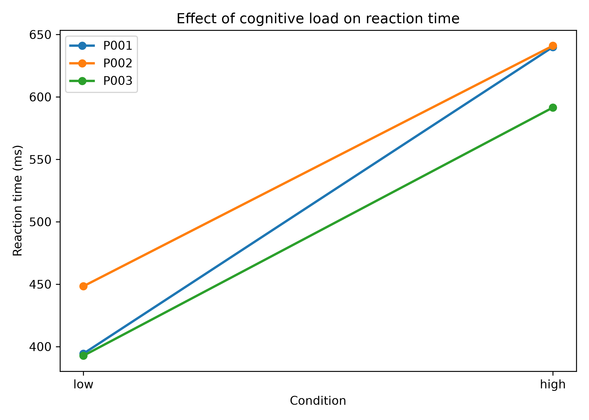

# neuroscience-data-analysis
independent mini-project exploring data analysis + visualization + reproducible research

## about
this repository documents my development of independent python programming and scientific data analysis skills. as an undergraduate neuroscience researcher, I am interested in applying computational methods to investigate questions about brain function and human behaviour.

## goals
-develop proficiency in python 

-learn to organize, process, and visualize hypothetical experimental data

-apply statistical methods to neuroscience-adjacent datasets

-build reproducible scientific analysis workflows for future projects

## current project: cognitive load and reaction time
this project uses a synthetic dataset simulating a repeated-measures experiment examining reaction times under low and high cognitive load. the analysis compares mean reaction times between both cognitive load conditions using a paired-samples t-test to assess within-participant differences. the current dataset contains 3 simulated participants, each completing 3 trials per condition, for 18 trials total (to be iterated for larger samples/datasets later).

## dataset + preprocessing
synthetic data generated using Python and exported to csv

each trial includes a participant ID, trial number, cog-load condition, reaction time in ms, and response accuracy

the pipeline inspects data for missing values and reports response accuracy, flags reaction times outside a predefined validity window, excludes invalid reaction times and incorrect trials from the primary analysis, reports exclusions and retention rates, and checks that participants have retained observations in both conditions before paired comparisons

## analysis
the following analyses were performed using pandas, NumPy, and SciPy:

-trial-level data generation + csv export

-data loading, filtering, and descriptive statistic presentation

-aggregation of participant-level data + within-participant comparisons

-standard deviation + standard error calculations

-paired-samples t-testing

-manual verification of stats against SciPy implementation

## visualization
a paired-line plot illustrating each participants' mean reaction times (in ms) across the two cognitive-load conditions was generated using Matplotlib

## simulated results
after simulating a differential effect between high-load and low-load reaction times, resulting synthetic data show higher mean reaction times under high cognitive load with an average within-participant difference of approx. 212 ms (95% CI = [140.39, 284.390] ms). a paired-samples t-test returned a p-value of approx. 0.006, with t(2) = 12.692.

after simulating an incorrect trial in the dataset, the final preprocessed dataset retained 17 of 18 simulated trials across all participants.

results are purely illustrative! the concluded effect was intentionally built into the code + sample size is way too small to support any meaningful empirical conclusions if the data was real.

## tools and libraries
-Python

-pandas

-NumPy

-SciPy

-Matplotlib

## data + academic integrity
this project uses independently developed code and synthetic datasets (no confidential research data from my, or other, thesis projects).

## status
[in progress]

future development will introduce larger dataset iterations + additional visualization methods

## running the project

install required libraries:

  python3 -m pip install -r requirements.txt

run scripts in this order:

1. `python3 src/generate_data.py`
2. `python3 src/analyze_rt.py`

1 = generate synthetic dataset and saves to data/synthetic_trials.csv, 2 = do statistical analyses + save plot in `figures/`
